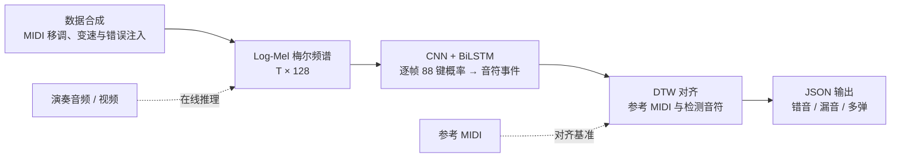

<div align="center">

# Piano Error Detection

### 基于 CNN + BiLSTM + DTW 的钢琴错音识别系统

**输入一段演奏音频，自动检测错音、漏音和多弹，输出带时间戳的 JSON 报告与可视化时间轴。**

</div>

---

## 项目简介

Piano Error Detection 是一个端到端的钢琴演奏错误检测系统。用户上传演奏录音（WAV / MP3）或演奏视频（MP4，自动抽取音轨），并附上对应的参考 MIDI 乐谱，系统即可完成：

1. **频谱提取**：librosa 计算 log-mel 频谱（sr=22050, n_mels=128, hop=512）；
2. **逐帧琴键检测**：CNN 提取时频特征，BiLSTM 建模时序上下文，输出 88 个琴键的逐帧激活概率；
3. **音符事件提取**：概率矩阵经平滑、阈值化、去毛刺和同音高去重，转换为离散音符序列；
4. **DTW 对齐找错**：检测音符与参考 MIDI 进行动态时间规整对齐，区分错音、漏音和多弹；
5. **结构化输出**：JSON 错误报告 + 标红时间轴可视化。

核心亮点：

- **多格式输入**：WAV、MP3 音频直接解码，MP4 视频自动抽取音轨（内置 ffmpeg，无需系统安装）。
- **训练与演示分离**：数据合成、模型训练、评估、推理和网页展示由 8 个独立模块负责，可单独运行和替换。
- **真实录音可用**：使用 SoundFont 渲染训练数据，弥合合成音色与真实钢琴的分布差异；同分布测试集 F1 = 0.9878。
- **零配置启动**：`python app.py` 一键启动 Gradio 网页，支持本地访问和公网分享。

## 架构流程



**离线阶段**：`make_dataset.py` 从 `midi_songs/` 九首曲目合成 1000 段带错误标注的训练样本，`train.py` 完成模型训练并保存权重。

**在线阶段**：`app.py` 串联频谱提取、模型推理、音符后处理和 DTW 对齐，训练与推理使用完全一致的音频频谱参数，保证特征分布匹配。

## 目录结构

```text
Piano_Project/
├── app.py                     # Gradio 网页与推理流程编排（入口）
├── make_dataset.py            # 数据合成：MIDI 错误注入 + SoundFont 渲染 + 特征提取
├── piano_dataset.py           # PyTorch Dataset：mel/label 加载、zero-padding、形状变换
├── model.py                   # 模型定义：CNN 特征提取器 + BiLSTM 分类器
├── train.py                   # 模型训练：BCELoss + Adam + Loss 曲线
├── evaluate.py                # 测试集评估：多阈值指标 + 混淆矩阵
├── post_process.py            # 推理后处理：概率矩阵 → 离散音符事件
├── dtw_align.py               # DTW 对齐与错误判定（可独立运行自测）
├── draw_diagrams.py           # 架构图、开发流程图绘制
├── _launch_bg.py              # Windows 后台启动辅助脚本
├── _train_to_temp.py          # 临时目录训练驱动
├── _eval_to_temp.py           # 临时目录评估驱动
├── data/features/             # mel_*.npy 与 label_*.npy 训练样本
├── midi_songs/                # 9 首 MIDI 合成语料（小星星、欢乐颂等）
├── piano_model.pth            # 训练后的模型权重
├── piano.sf2                  # 钢琴 SoundFont（仅重新合成数据时需要）
├── test_ids.json              # 固定的训练集 / 测试集划分
├── loss_curve.png             # 训练损失曲线
├── dtw_path.png               # DTW 对齐路径图
├── confusion_matrix.png       # 测试集混淆矩阵
├── evaluation_report.txt      # 测试集评估报告
├── requirements.txt           # Python 依赖清单
└── README.md
```

### 模块职责与解耦设计

| 模块 | 文件 | 职责 | 解耦要点 |
| --- | --- | --- | --- |
| 数据合成 | `make_dataset.py` | 读取 MIDI 语料，执行移调、变速、时序扰动和错音/漏音/多弹注入，渲染音频并生成 log-mel 频谱与 88 键标签 | 独立运行，不依赖模型或网页模块 |
| 数据读取 | `piano_dataset.py` | 加载 `mel_*.npy` 和 `label_*.npy`，将时间维补齐或截断为 512 帧，向训练与评估模块提供统一张量 | 仅依赖 NumPy + PyTorch，与数据合成解耦 |
| 模型定义 | `model.py` | 定义 CNN 特征提取器、BiLSTM 分类器和完整的 `PianoErrorModel` | 纯模型结构，不包含训练或推理逻辑 |
| 模型训练 | `train.py` | 按 8:2 划分数据，使用 BCELoss、Adam 和 20 个 epoch 训练，保存模型权重、数据划分及损失曲线 | 调用 `piano_dataset` 和 `model`，不依赖推理模块 |
| 模型评估 | `evaluate.py` | 在测试集上计算准确率、精确率、召回率和 F1，输出混淆矩阵、评估报告及多阈值诊断 | 复用训练的数据划分，独立于推理流程 |
| 推理后处理 | `post_process.py` | 对逐帧概率进行平滑、阈值化、连续段合并、去毛刺和同音高去重，生成带起止时间的音符事件 | 纯函数接口，输入概率矩阵、输出音符列表，可独立测试 |
| 对齐与判定 | `dtw_align.py` | 独立实现 DTW 对齐、错音/漏音/多弹分类、音名转换及路径图绘制 | `python dtw_align.py` 可直接运行自测，不依赖其他业务模块 |
| 网页交互 | `app.py` | 处理文件上传与视频抽音轨，编排频谱提取、推理、后处理和 DTW 对齐，展示 JSON 与时间轴 | 调用各模块的组合器，自身不包含模型或 DTW 实现 |
| 图表工具 | `draw_diagrams.py` | 绘制系统总体架构图和开发流程图 | 纯工具脚本，不参与训练或推理 |
| 后台启动 | `_launch_bg.py` | 在 Windows 下以无控制台窗口方式启动 `app.py`，并检查 7860 端口是否就绪 | 部署辅助，与核心逻辑无关 |

这种拆分使数据、模型、算法和界面可以独立开发、测试和替换；`app.py` 负责调用各模块，而不是重复实现模型或 DTW 逻辑。

## 安装与运行

### 环境要求

- Python 3.10+（本项目已在 Python 3.12 验证）
- Windows、macOS 或 Linux；后台启动辅助脚本 `_launch_bg.py` 仅适用于 Windows

### 创建环境并安装依赖

```powershell
# 克隆项目后进入目录
cd Piano_Project

# 创建虚拟环境
python -m venv .venv
.\.venv\Scripts\Activate.ps1   # Windows PowerShell
# source .venv/bin/activate     # macOS / Linux

# 安装依赖
python -m pip install --upgrade pip
pip install -r requirements.txt
```

主要依赖包括 PyTorch、NumPy、librosa、SoundFile、pretty_midi、SciPy、scikit-learn、Matplotlib、Gradio 和 imageio-ffmpeg，具体版本以 `requirements.txt` 为准。MP4 音轨提取优先使用 imageio-ffmpeg 自带的 ffmpeg，无需单独安装系统级 ffmpeg。

> `requirements.txt` 默认使用 CPU 版 PyTorch。如需 GPU 加速，请根据 [PyTorch 官方指引](https://pytorch.org/get-started/locally/) 安装与本机 CUDA 环境匹配的版本。

### 启动 Gradio 演示

项目根目录已有 `piano_model.pth` 时，无需重新训练，直接启动：

```powershell
python app.py
```

启动后访问 <http://127.0.0.1:7860>，上传演奏文件和参考 MIDI，点击"开始分析"。

> 模型单次分析约 11.9 秒音频，超出部分会截断；演示素材建议控制在 11 秒以内。

### 分析结果：错误列表与时间轴

点击“开始分析”后，页面会同时生成两类结果：

- **JSON 错误列表**：展示参考音符数、检测音符数、错音/漏音/多弹数量、DTW 总代价，以及 `errors` 数组中每个错误的时间、参考音名和实际音名。
- **可视化时间轴**：浅蓝色表示参考 MIDI 音符，绿色表示实际检测音符，红色表示判定为错误的音符，并在图内列出错误明细。

当模型未检测到有效演奏音符时，系统不再将空列表传入 DTW，而是进行空预测保护：

1. `num_detected_notes` 返回 `0`；
2. 参考 MIDI 中的全部音符标记为 `missed`，错误列表和时间轴仍会正常显示；
3. 当前 Gradio 内部统计中的 `dtw_total_cost` 返回 `null`，表示没有可计算的 DTW 对齐路径。

因此，空预测属于一种可展示的分析结果，不会导致 JSON 或时间轴组件报错。

### 可选：完整复现训练流程

重新合成数据还需安装 FluidSynth 的 Python 绑定，并准备钢琴 SoundFont：

```powershell
pip install pyfluidsynth
```

将 SoundFont 文件命名为 `piano.sf2` 并放到项目根目录，然后依次执行：

```powershell
python make_dataset.py   # 生成 data/features/ 下的样本与标签
python train.py          # 训练模型并保存权重、损失曲线和数据划分
python evaluate.py       # 生成评估报告与混淆矩阵
python dtw_align.py      # 运行 DTW 自测并生成 JSON 与路径图
python app.py            # 启动网页演示
```

仅启动网页演示不需要 `piano.sf2`，也不需要重新执行数据合成和训练。

## JSON 接口说明

对外集成时，错误结果统一采用以下结构。`error_code = 0` 表示分析流程成功，不表示没有演奏错误；未检测到错误时 `data` 为空数组。

### 字段定义

| 字段 | 类型 | 说明 |
| --- | --- | --- |
| `error_code` | `int` | 状态码：`0` 表示成功，非 `0` 表示处理失败 |
| `data` | `array` | 错误事件数组，按错误发生时间排序 |
| `timestamp` | `float` | 错误时间戳（秒）；错音和多弹使用实际演奏时间，漏音使用参考音符时间 |
| `error_type` | `string` | 错误类型：`WrongNote`（错音）、`MissingNote`（漏音）或 `ExtraNote`（多弹） |
| `expected_note` | `string \| null` | 参考 MIDI 中应演奏的音名；多弹时为 `null` |
| `actual_note` | `string \| null` | 实际检测到的音名；漏音时为 `null` |

### 检测到错误示例

```json
{
  "error_code": 0,
  "data": [
    {
      "timestamp": 5.1,
      "error_type": "WrongNote",
      "expected_note": "C4",
      "actual_note": "D4"
    },
    {
      "timestamp": 7.3,
      "error_type": "MissingNote",
      "expected_note": "E4",
      "actual_note": null
    },
    {
      "timestamp": 9.8,
      "error_type": "ExtraNote",
      "expected_note": null,
      "actual_note": "G4"
    }
  ]
}
```

### 无错误示例

```json
{
  "error_code": 0,
  "data": []
}
```

### 处理失败示例

```json
{
  "error_code": 1,
  "data": [],
  "message": "文件处理失败，请检查上传的音频和 MIDI 文件是否正确"
}
```

> **内部字段映射**：`dtw_align.py` 的内部字段为 `type`、`expected`、`played`、`ref_onset` 和 `played_onset`；对外提供上述结构时，分别映射为 `error_type`、`expected_note`、`actual_note` 和 `timestamp`，其中 `wrong / missed / extra` 对应 `WrongNote / MissingNote / ExtraNote`。当前 Gradio 页面还直接展示错误数量、DTW 总代价等统计字段，并非独立的 REST API。

## 部署说明

### 本地运行

```powershell
python app.py
```

- 本机访问：<http://127.0.0.1:7860>
- `app.py` 使用 `server_name="0.0.0.0"` 和固定端口 `7860`，同一局域网内的设备可通过 `http://<本机局域网IP>:7860` 访问
- 若局域网设备无法访问，请检查系统防火墙是否允许 Python 接收入站连接，并确保服务进程持续运行

### 公网分享（Gradio share）

`app.py` 会在网络可用时自动尝试以 `share=True` 启动；成功后，终端会输出一个临时的 `*.gradio.live` 公网链接。无法连接分享服务时会自动回退到本地模式。也可在 `app.py` 底部的 `demo.launch(...)` 中手动调整：

```python
demo.launch(server_name="0.0.0.0", server_port=7860, share=True)
```

> **国内网络提示**：Gradio 公网分享依赖 Hugging Face 隧道服务，在中国大陆网络环境下可能出现无法生成链接、连接不稳定或公网链接无法访问等情况。这不会影响 `127.0.0.1` 本地访问或局域网直连。如遇分享失败，系统会自动降级为仅本地模式，终端会输出提示信息。

公网分享链接适合临时演示，请勿上传包含隐私或敏感信息的音频、视频；正式公开部署时应另行配置访问控制和安全防护。

### 演示视频

项目提供 20 秒演示视频，展示完整分析流程：上传音频 → 模型推理 → JSON 错误报告 → 时间轴标红可视化。

## 许可证

本项目仅供学习和研究使用。

## 致谢

- [librosa](https://github.com/librosa/librosa)：音频处理与 DTW 对齐
- [PyTorch](https://pytorch.org/)：深度学习框架
- [Gradio](https://gradio.app/)：网页演示界面
- [pretty_midi](https://github.com/craffel/pretty-midi)：MIDI 解析与处理
- [FluidSynth](https://www.fluidsynth.org/)：SoundFont 音频渲染
