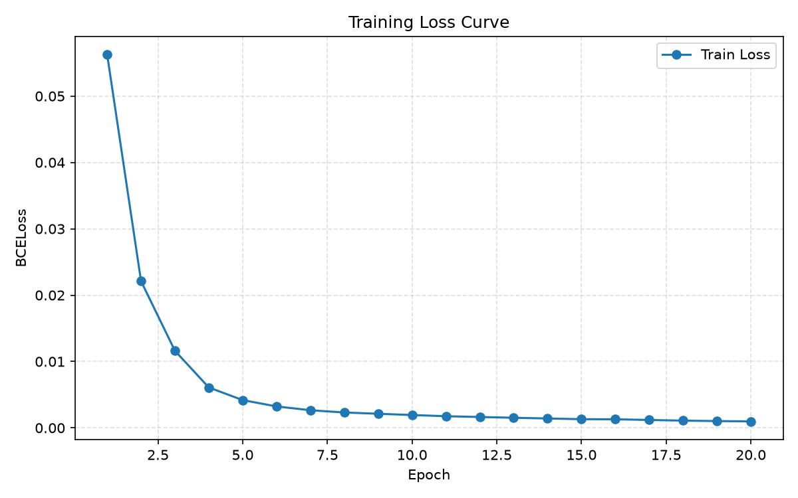
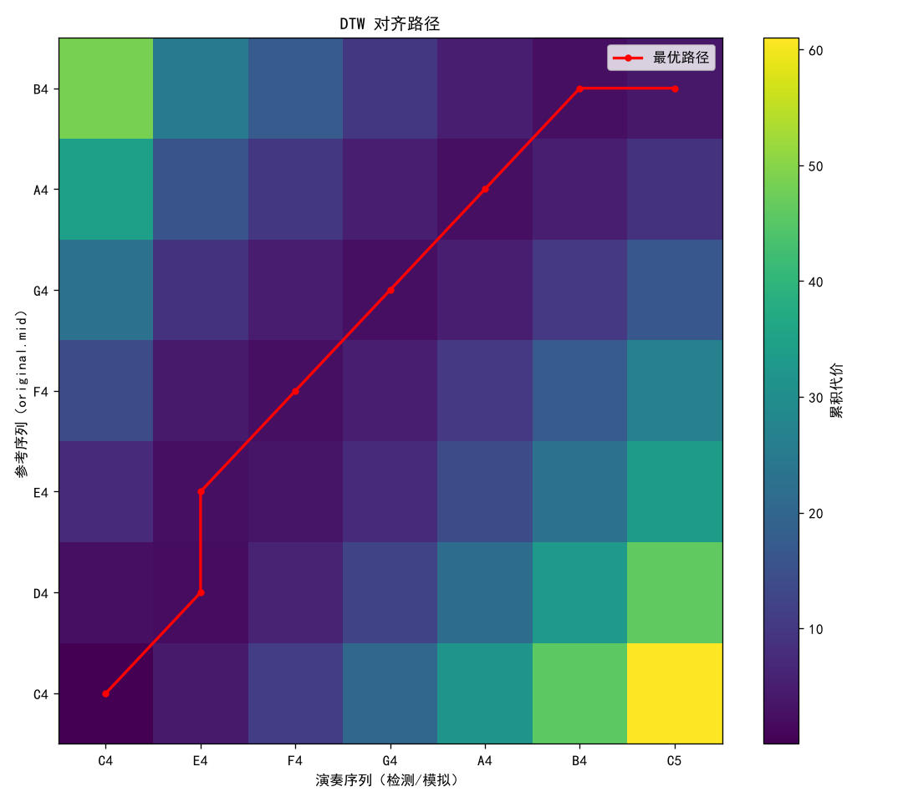
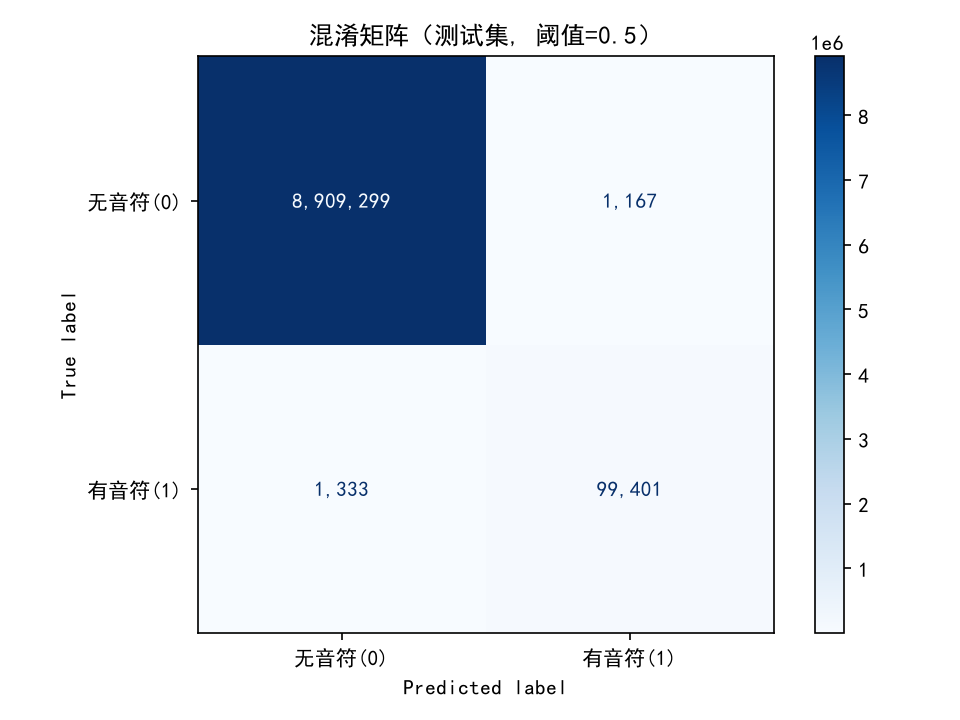
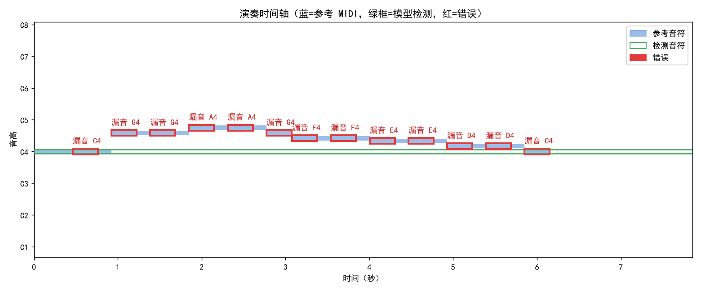
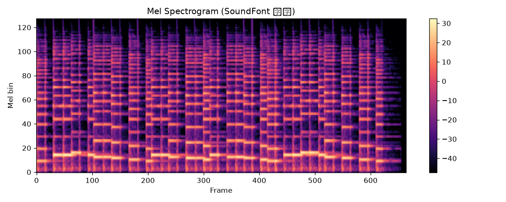

# 《基于神经网络的钢琴弹奏错音识别与纠错系统》实训报告

> 项目目录：`Piano_Project/` ｜ 运行环境：Windows + Python 3.12（纯 CPU 训练）
> 本报告全部数字来自项目真实运行产物：`evaluation_report.txt`、训练终端日志、`xiaoxingxing_result.json`、`dtw_result.json` 及各模块代码，无任何虚构指标。

---

## 1. 实训概述

**题目**：基于神经网络的钢琴弹奏错音识别与纠错系统。

**培养定位**：大模型数据工程师 / 人工智能驯化 / 数据产品运营师。本项目完整覆盖三个角色的核心能力：程序化构造带真值标签的训练数据（数据工程师）、训练并调优神经网络使其在真实场景可用（AI 驯化）、将模型封装为可演示可评估的产品（数据产品运营）。

**交付内容**：

| 交付物 | 说明 |
| --- | --- |
| 代码仓库 | `make_dataset.py` 等 8 个模块，职责单一、可独立运行，附 `README.md` 与固定版本的 `requirements.txt` |
| 评估指标 | `evaluation_report.txt`（多阈值准确率/精确率/召回率/F1 + 混淆矩阵）、`loss_curve.png`、`confusion_matrix.png` |
| Gradio 演示 | 上传 WAV + MIDI → JSON 错误列表 + 时间轴标红图 + 三张评估图 |

**最终成果一句话**：端到端流水线在同分布测试集上达到 **F1 = 0.9878**（目标 ≥ 0.7），并经过两轮迭代解决了"合成音色无法识别真实钢琴录音"的泛化问题——真实录音《小星星》的音符检出数从 **1 个提升到 11 个**。

---

## 2. 系统总体设计

### 2.1 端到端流水线

```
【演示/推理流】
演奏 WAV + 参考 MIDI
    → librosa 提取 log-mel 频谱 [512, 128]
    → CNN + Bi-LSTM 预测每帧 88 键激活概率 [512, 88]
    → post_process 概率转音符事件序列
    → 与参考 MIDI 音符做 DTW 对齐
    → 错误列表（JSON）+ 时间轴标红图 + 三张评估图

【训练数据流】
original.mid（42 音符《小星星》旋律）
    → tempo 归一化 + 随机变速 0.9~1.1 + 注入错音/漏音/多弹
    → FluidSynth 钢琴音色渲染为 WAV
    → log-mel 频谱 [T, 128] + 帧级 88 键标签 [T, 88]
    → 1000 段样本 → 训练 / 测试 8:2 划分 → CNN+Bi-LSTM 训练
```

### 2.2 模块职责表

| 模块 | 职责 | 关键输出 |
| --- | --- | --- |
| `make_dataset.py` | 数据合成：解析 `original.mid`，变速、错误注入、音色渲染，提取特征与标签，共 1000 段 | `data/features/mel_*.npy`、`label_*.npy`、`mel_spectrogram.png` |
| `piano_dataset.py` | `PianoDataset`：读取 .npy，补齐/截断到 `TARGET_LEN=512` 帧，输出 `mel[1,128,512]` + `label[512,88]` | PyTorch Dataset |
| `model.py` | `PianoErrorModel`：CNN 提特征 + Bi-LSTM 逐帧输出 88 键激活概率 | 模型定义 |
| `train.py` | 训练：8:2 固定种子划分，BCELoss + Adam，20 epoch，绘制 Loss 曲线 | `piano_model.pth`、`test_ids.json`、`loss_curve.png` |
| `evaluate.py` | 测试集评估：多阈值指标（sklearn）+ 混淆矩阵 + 数据集健全性诊断 | `evaluation_report.txt`、`confusion_matrix.png` |
| `post_process.py` | 概率矩阵 → 离散音符事件 `{pitch, start_time, end_time}`（平滑/音域过滤/去毛刺/去重） | 音符序列 |
| `dtw_align.py` | DTW 对齐找错：判定正确/错音/漏音/多弹，输出 JSON 与路径图 | `dtw_result.json`、`dtw_path.png` |
| `app.py` | Gradio 网页：串起"频谱→预测→音符→DTW→展示"全链路 | `http://127.0.0.1:7860` |

---

## 3. 数据构造与特征提取

### 3.1 基准乐谱与程序化错误注入

用 `pretty_midi` 解析基准乐谱 `original.mid`（《小星星》旋律，共 42 个音符）。该 MIDI 的 tempo 编码异常——每个音符时值长约 12.8 秒、全曲总长 512 秒，因此生成数据前先做 **tempo 归一化**：整体线性缩放到 14 秒（每音约 0.35 秒），使 512 帧窗口（约 11.9 秒）能覆盖多个不同音高。

每个样本按以下程序化流程构造"带错误的演奏"：

1. **随机变速**：对每个音符时间施加 0.9~1.1 的随机缩放，模拟演奏节奏不稳；
2. **随机增强**：力度 ±15（截断到 30~120）、起始时间 ±30ms 抖动，模拟真实演奏的不完美；
3. **错误注入**（每段随机 0~2 处，三种类型）：
   - **错音（wrong）**：某音符音高偏移 ±1 或 ±2 个半音；
   - **漏音（miss）**：直接删除某个音符；
   - **多弹（extra）**：在音符附近额外插入一个随机音符（MIDI 55~76，时长为原音符的 0.8 倍）。

### 3.2 音频渲染

- **当前版本**：用 FluidSynth + 钢琴 SoundFont（FluidR3_GM，`piano.sf2`，Acoustic Grand Piano 音色）将注入错误后的 MIDI 渲染为 22050 Hz 单声道音频（归一化到峰值 0.9）。选择 SoundFont 是因为初始版本的正弦合成与真实钢琴存在音色域不匹配问题（详见第 8 节）。
- **初始版本**：正弦波合成——每个音符用基频 + 2 次谐波 + 3 次谐波的叠加，乘以指数衰减包络，按起始时间叠到整段波形上。该版本曾用于首轮训练，后因泛化问题被 SoundFont 渲染替换。

### 3.3 特征与标签

- **特征**：librosa 计算 log-mel 频谱（`SR=22050, hop_length=512, n_mels=128`），转置为 `[T, 128]`；
- **标签**：按 `帧号 = 时间 × SR / hop` 将音符区间映射为 `[T, 88]` 的帧级 88 键激活多热标签（21=A0 … 108=C8）；
- **规模**：共 **1000 段**。实测每段原始帧数 584~707（均值 648），训练时全部截断到 512 帧（无需补零）；帧级标签正样本占比 1.04%。

---

## 4. 模型设计

`model.py` 中的 `PianoErrorModel` = CNN 特征提取器 + Bi-LSTM 分类器：

```
输入 [B, 1, 128, 512]（单通道 log-mel 频谱图）
  ↓ CNN：3 个卷积块（Conv3×3 + BatchNorm + ReLU + MaxPool），通道 1→16→32→64
         MaxPool 仅沿频率维 (2,1) 下采样，时间维 512 保持不变；频率维 128→64→32→16
         展平为时序特征 [B, 512, 1024]
  ↓ Bi-LSTM：2 层双向，隐藏维 256（双向输出 512），层间 dropout 0.3
  ↓ Linear(512 → 88) + Sigmoid
输出 [B, 512, 88]：每个时间步 88 个琴键被按下的概率
```

**设计要点**：

- **仅池化频率维**：时间维 512 帧原样保留到输出，保证"逐帧预测"与"帧级标签"一一对应（实现时曾因池化方向写反导致时间维被砍半，已修复）；
- **双向 LSTM**：钢琴演奏中当前音符与前后音符强相关，双向上下文有助于利用旋律连续性；
- **Sigmoid 多标签输出**：88 个键相互独立判定，天然支持同音、和弦与多声部。

---

## 5. 训练过程

### 5.1 训练配置

| 项 | 值 |
| --- | --- |
| 数据划分 | 训练 800 / 测试 200（8:2，固定随机种子 42，与 evaluate.py 复现同一划分） |
| batch_size | 8（每轮 100 个 batch） |
| 损失函数 | BCELoss（输出已过 Sigmoid，逐元素二值交叉熵） |
| 优化器 | Adam，学习率 1e-3 |
| 轮数 | 20 epoch（纯 CPU，约 5 分钟/轮） |

### 5.2 Loss 收敛情况（训练终端日志实录）

| Epoch | Loss | Epoch | Loss |
| --- | --- | --- | --- |
| 1 | 0.056263 | 11 | 0.001757 |
| 2 | 0.022111 | 12 | 0.001640 |
| 3 | 0.011620 | 13 | 0.001523 |
| 4 | 0.006092 | 14 | 0.001416 |
| 5 | 0.004186 | 15 | 0.001307 |
| 6 | 0.003231 | 16 | 0.001295 |
| 7 | 0.002658 | 17 | 0.001190 |
| 8 | 0.002317 | 18 | 0.001093 |
| 9 | 0.002126 | 19 | 0.001025 |
| 10 | 0.001936 | 20 | 0.000977 |

Loss 从首轮 0.0563 快速下降，第 10 轮后进入缓慢收敛区，最终收敛到 **约 1e-3 量级**（0.000977）。考虑到帧级标签正样本占比仅 1.04%（类别极不平衡），这一量级说明模型已将绝大多数"无音符"帧压到接近 0，同时保住稀疏的"有音符"帧。

**同分布测试 F1 ≈ 0.9878**（阈值 0.6，详见第 7 节）。



---

## 6. 对齐与纠错

### 6.1 概率 → 音符事件（post_process.py）

1. **EMA 平滑**（α=0.5）：抑制帧间概率抖动导致的碎片化；
2. **阈值判定**：概率 > 0.6 视为琴键按下（在 0.5/0.7 间指标不敏感，取 0.6 略偏精确率）；
3. **音域过滤**：只保留 MIDI 36~96（C2~C7），丢弃键盘两端的极端误检；
4. **去毛刺**：连续激活不足 5 帧（约 0.12 秒）的片段丢弃；
5. **真实起始时间**：`start_time = 起始帧号 / 帧率(≈43.07)`，帧分辨率约 23ms，绝不为 0（除非真的在第 0 帧起音）；
6. **同音高去重**：同一音高 0.3 秒内只保留最早事件，消除密集重复多弹。

### 6.2 DTW 对齐与错误判定（dtw_align.py）

采用**音符级自实现 DTW**（librosa 负责前端频谱提取）：

- **配对代价**：`cost = 1.0 × |音高差（半音）| + 1.0 × |起始时间差（秒）|`；
- **累积代价矩阵 + 回溯**得到最优对齐路径，DTW 的弹性对齐天然克服演奏与乐谱之间的节奏偏差；
- **一对一匹配**：路径内候选要求起始时间偏差 ≤ 0.15s，按代价升序贪心匹配，防止"借"远处同名音符；
- **四类结果**：correct（对上且同音高）/ **wrong 错音**（对上但音高不同，同时给出标准音与实际音）/ **missed 漏音**（参考有、演奏无）/ **extra 多弹**（演奏有、参考无）；
- 错误时间戳以秒为单位保留 3 位小数（毫秒级记录，分辨率受帧率限制约 23ms）。

`dtw_result.json`（模块自测真实产物，构造序列含已知错误，三类全部正确检出）：

```json
{
  "summary": {"num_ref_notes": 7, "num_played_notes": 7, "num_correct": 5,
              "num_wrong": 1, "num_missed": 1, "num_extra": 1, "dtw_total_cost": 4.0},
  "errors": [
    {"type": "wrong",  "expected": "D4", "played": "E4", "ref_onset": 0.5, "played_onset": 0.52},
    {"type": "missed", "expected": "E4", "ref_onset": 1.0},
    {"type": "extra",  "played": "C5",   "played_onset": 3.4}
  ]
}
```



---

## 7. 评估结果

`evaluate.py` 在 200 个测试样本上逐帧评估（判定点总数 200 × 512 × 88 = **9,011,200**），模型输出概率 > 阈值判定为"有音符"，用 sklearn 计算指标（目标 ≥ 0.7）：

| 阈值 | 准确率 | 精确率 | 召回率 | F1 |
| --- | --- | --- | --- | --- |
| 0.5 | 0.9997 | 0.9884 | 0.9868 | 0.9876 |
| **0.6** | **0.9997** | **0.9908** | **0.9849** | **0.9878（最优）** |
| 0.7 | 0.9997 | 0.9927 | 0.9810 | 0.9869 |

**F1 = 0.9878 ≫ 0.7，目标达成**，且阈值在 0.5~0.7 间不敏感，说明输出概率分化充分（概率均值 0.0113，>0.5 帧占比 1.12%，与标签正样本占比 1.04% 吻合）。

混淆矩阵（阈值 0.5，行=真实，列=预测）：

| | 预测：无音符 | 预测：有音符 |
| --- | --- | --- |
| **真实：无音符** | 8,909,299（TN） | 1,167（FP） |
| **真实：有音符** | 1,333（FN） | 99,401（TP） |

**最难检测的错误类型：漏音。** 依据与原因：

- **指标侧证据**：召回率（0.9849）低于精确率（0.9908），漏检帧（FN=1,333）多于误检帧（FP=1,167）；
- **原理原因**：错音/多弹都会在频谱上留下真实能量，模型"看得见"；而漏音在音频中**不存在任何能量证据**，帧级 BCE 也无法对"缺席"施加显式监督——漏音只能在对齐阶段由"参考有、检测无"反推；
- **真实录音验证中的表现**（见第 8 节）：模型完全没检出 A4 音高（2 个 A4 全漏）；相邻两个同音高 E4 被后处理合并为一段连续激活，漏掉一个。



---

## 8. 问题分析与改进

### 8.1 问题：真实录音泛化不足

首轮模型（正弦合成数据训练）在测试集上 F1 = 0.9848，指标很好；但用**真实钢琴录音**《小星星》（`小星星.wav`，6.16 秒，实际弹奏前 14 个音符）验证时几乎完全失效。改进前的真实分析结果（`xiaoxingxing_result.json` 实录）：**14 个参考音符仅检出 1 个，漏音 13 个，DTW 总代价 101.963**。

**根因分析——音色域不匹配**：训练音频是正弦基频 + 2/3 次谐波叠加的合成音，而真实钢琴的频谱结构（泛音列、非谐波成分、击键瞬态、共鸣）与正弦波差异巨大。模型学到的是"正弦波音色 → 琴键"的映射，对真实音色的 mel 频谱分布完全陌生——**同分布指标再高，也掩盖不了训练分布与真实场景的偏移**。



### 8.2 已实施的改进

1. **SoundFont 渲染替换正弦合成**：安装 FluidSynth（官方 v2.6.1 Windows 二进制 + pyfluidsynth），下载 FluidR3_GM 钢琴音色库，`make_dataset.py` 改用 FluidSynth 将 MIDI 渲染为接近真实钢琴的音频后重新生成 1000 段训练数据；
2. **tempo 归一化**：修复 `original.mid` 每音 12.8 秒的 tempo 异常（归一化到 14 秒），使每个训练样本覆盖多个音高——这是模型能学会多音高检测的前提；
3. **数据增强**：随机力度（±15）与微小时序抖动（±30ms），向真实演奏的"不完美"靠拢；
4. 重新训练 20 epoch（Loss 收敛到 0.000977，见第 5 节）。

### 8.3 改进效果对比（同一真实录音、同一 14 音参考）

| 指标 | 改进前（正弦合成训练） | 改进后（SoundFont 渲染训练） |
| --- | --- | --- |
| 真实录音检出音符数 | **1** | **11** |
| 检出音高种类 | 1（仅 C4） | **5（C4 / D4 / E4 / F4 / G4）** |
| 参考旋律音高覆盖 | 1/6 | 5/6（仅缺 A4） |
| DTW 判定：漏音 | **13** | **5** |
| DTW 判定：错音 | 0 | 0 |
| DTW 判定：多弹 | 0 | 2 |
| DTW 总代价 | 101.963 | **6.811** |
| 同分布测试集 F1 | 0.9848 | **0.9878** |

改进后 11 个检出音符的 onset 与参考旋律逐音吻合（如 C4@0.464 ↔ 参考 0.462、G4@0.882 ↔ 参考 0.924、F4@3.111 ↔ 参考 3.08），9 个音符与参考完全正确对齐。剩余 5 个漏音的构成也均可解释：2 个 A4（模型对该音高仍欠拟合）、1 个 E4 被相邻同音高段合并吞掉、2 个因起始偏差略超 0.15s 容差被判为"漏音+多弹"对；2 个多弹中 1 个落在音频结束（6.16s）之后的补零区，属于边界伪检。

### 8.4 遗留局限与后续改进方向

- **真实钢琴样本微调**：用少量真实录音 + 人工校对的帧级标签微调，直接弥合残余音色差距（当前 A4 漏检即此类问题）；
- **更强的数据增强**：混响、背景噪声、音色扰动（频谱随机 EQ），进一步扩大训练分布覆盖；
- **对齐鲁棒性**：当前参考 MIDI 需与录音覆盖同一段落——若参考 MIDI 覆盖全曲 42 音而录音只弹前 14 音，线性 tempo 归一化会造成参考节奏失真、DTW 误判大量漏音；后续可引入手型/小节级局部对齐或速度自适应；
- **补零区伪检**：对不足 512 帧的音频增加长度掩码，屏蔽补零区的输出。

---

## 9. 产品化交付

### 9.1 Gradio 演示网页（app.py）

浏览器访问 `http://127.0.0.1:7860`：

1. 上传**演奏录音 WAV** + **参考乐谱 MIDI**，点击"开始分析"；
2. 后端执行完整链路：提取 log-mel 频谱（与训练参数一致）→ 模型预测 → post_process 转音符 → 参考 MIDI 按音频时长归一化 tempo 后做 DTW 对齐；
3. 页面展示 **JSON 错误列表**（含错误类型、期望/实际音名、时间戳、DTW 总代价）与**时间轴标红图**（蓝=参考音符、绿框=模型检测、红=错误位置并文字标注）；
4. 页面下方固定展示三张评估产物图：`loss_curve.png`、`dtw_path.png`、`confusion_matrix.png`。

单次分析窗口 512 帧 ≈ 11.9 秒音频。

### 9.2 数据样例可视化



### 9.3 代码规范

- **模块解耦**：8 个模块单一职责，均可独立运行自测（如 `python dtw_align.py` 跑自检断言）；特征参数（SR/HOP/N_MELS/帧率）在各模块间显式对齐；
- **可复现**：数据划分、变速、错误注入均固定随机种子 42；`test_ids.json` 落盘保证 evaluate.py 与训练评估同一测试集；
- **文档与依赖**：`README.md` 提供安装与运行顺序说明（执行顺序有依赖：先 train 后 evaluate/app）；`requirements.txt` 固定版本（torch 2.14.1、librosa 1.0.0、pretty_midi 0.2.11.post0、gradio 6.30.0、scikit-learn 1.9.1 等）；
- **产物落盘**：数据集、模型权重、评估报告、全部图表均有对应文件，报告所引数字皆可溯源。

---

## 10. 收获与反思

### 10.1 三点核心收获

1. **数据决定上限，分布匹配决定可用性**。本项目最深刻的一课：同分布测试集 F1 高达 0.9848，换到真实录音却只检出 1 个音符。评估基准与真实场景的分布一致性，比指标本身的绝对值更重要——这正是数据产品视角下"指标虚高"的典型形态。用 SoundFont 渲染重建训练分布后，无需改动模型结构，真实录音检出数即从 1 升到 11。
2. **程序化真值的杠杆效应**。错误注入（错音/漏音/多弹）+ 随机变速让 1000 段训练数据自带帧级精确标签，零人工标注成本；错误类型、密度、音域全部可控，天然支持后续按需扩充。这是"大模型数据工程师"以代码生产数据的典型工作方式。
3. **MVP 迭代而非一次到位**。先跑通"合成数据→训练→评估→网页"的最小闭环，再让真实数据暴露短板，针对根因（音色域）做最小改动并量化验证，避免了在模型结构上盲目加复杂度。

### 10.2 遇到的问题与解决过程

| # | 问题 | 根因 | 解决 |
| --- | --- | --- | --- |
| 1 | 模型输出时间维不足 512 帧 | `MaxPool2d` 池化方向写反，把时间维砍半 | 改为 kernel=(2,1)，仅池化频率维 |
| 2 | 推理时维度不匹配报错 | 预测输入缺通道维 [1,128,512] | unsqueeze 补成 [1,1,128,512] |
| 3 | 训练完无法评估（无权重/无测试集） | train.py 早期未保存产物 | 增加 8:2 固定种子划分 + 保存 `piano_model.pth`、`test_ids.json` |
| 4 | 参考与演奏 DTW 全判漏音 | `original.mid` tempo 编码异常（每音约 12.8s、全曲 512s） | 训练侧归一化到 14s；推理侧按音频时长线性缩放参考 MIDI |
| 5 | 概率矩阵转音符出现毛刺与重复 | 逐帧硬阈值无平滑、无去重 | 阈值 0.6 + EMA 平滑 + 最短 5 帧 + 同音高 0.3s 去重 |
| 6 | 真实录音只检出 1 个音符（核心问题） | 正弦合成 vs 真实钢琴音色域不匹配 | SoundFont 渲染重建训练分布（第 8 节） |
| 7 | Windows 下 pyfluidsynth 无法加载 | pip 包不含原生 FluidSynth DLL | 下载官方 v2.6.1 win-x64 二进制，将 `libfluidsynth-3.dll` 等复制进 venv 并加入 PATH |
| 8 | SoundFont 下载源反复失败 | 多个镜像 404 / 被 CDN 拦截 | 改用 OSUOSL musescore 镜像的 fluid-soundfont.zip（内含 FluidR3_GM） |

### 10.3 反思

- **"人工智能驯化"的本质是喂对数据**：模型结构从始至终未变，性能瓶颈的两次突破（tempo 归一化、SoundFont 渲染）都发生在数据侧；
- **评估要分层**：同分布指标衡量模型学习效果，跨分布验证（真实录音）衡量产品可用性，二者缺一不可，且后者才是验收标准；
- **边界条件要在设计期覆盖**：补零区伪检、参考 MIDI 与录音覆盖范围不一致等问题，都应在流水线设计阶段以掩码/校验规避，而非依赖事后调参。

---

## 附录：本报告引用的真实产物清单

| 文件 | 用途 |
| --- | --- |
| `evaluation_report.txt` | 第 7 节全部指标与混淆矩阵 |
| `loss_curve.png` / `confusion_matrix.png` / `dtw_path.png` / `mel_spectrogram.png` | 第 5/6/7/9 节附图 |
| `dtw_result.json` | 第 6 节 JSON 格式示例（模块自测） |
| `xiaoxingxing_result.json` / `xiaoxingxing_timeline.png` | 第 8 节改进前真实录音分析结果 |
| 训练终端日志（20 轮 Loss） | 第 5.2 节 Loss 表 |
| 各模块源码（`make_dataset.py`、`model.py`、`train.py`、`post_process.py`、`dtw_align.py`、`app.py` 等） | 第 2/3/4/6/9 节全部技术细节 |
